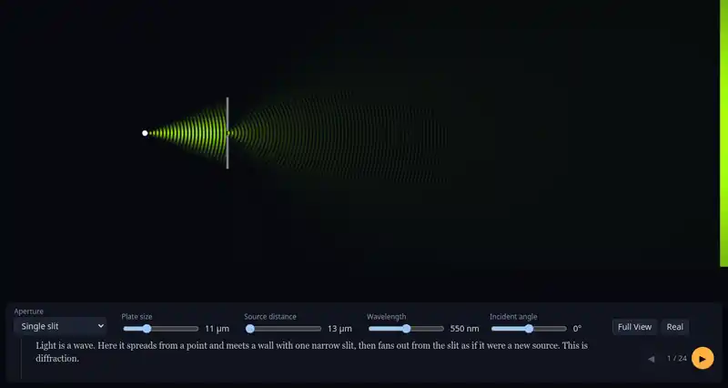

# enlighten

An interactive, browser-based light simulator for teaching the ideas behind holography, from
diffraction at a single slit toward holographic stereograms.

**Try it: https://jeffbreidenbach.github.io/enlighten/**



It shows light as a steady wave of one color passing a source, an aperture plate and a screen:

- **Apertures:** single slit, double slit, sine grating, and holograms of a point, two points,
  a square and a circle, including a square and a circle stacked on two plates.
- **Light:** a point source you can raise, lower or move away until it becomes a plane wave,
  in any color from blue to red.
- **Views:** a cross section through the middle of the setup showing the waves themselves, and a
  full 3D view of the aperture plate and the screen.
- **Real and virtual images:** reverse the beam, and an eye looks through the plate at the
  image behind it.
- **Tour:** the ◀ ▶ buttons step through a 24-stop guided tour, from a single slit to a
  holographic stereogram, changing one thing at a time and explaining what to notice. Every
  control also explains itself when changed.

The light is computed by summing Huygens wavelets from the aperture plate in WebGL shaders
(three.js), so it runs in any current browser on an ordinary laptop.

## Run

The quickest way is the copy on the web: https://jeffbreidenbach.github.io/enlighten/

To run your own, the simulator is a folder of static files, `src/enlighten/static/`, with
nothing to build or install: `index.html` is the whole app. Browsers will not load its scripts
straight from disk (a `file://` address), so serve the folder with any web server and point a
browser at it:

```bash
cd src/enlighten/static
python3 -m http.server
```

Then open http://localhost:8000/. Or use the server that comes with the project:

```bash
uv run enlighten
```

Then open http://localhost:8000/enlighten/. This one listens on all interfaces (`0.0.0.0`) on
port 8000; set `HOST` (for example `HOST=127.0.0.1` to keep it private) and `PORT` to change that.

## Layout

- `src/enlighten/__init__.py`: a small static file server.
- `src/enlighten/static/`: the simulator.
  - `physics/`: the core calculation.
    - `layout.js`: where everything sits, and the scale.
    - `aperture.js`: turns each aperture into the wavelets it sends on.
    - `wavefield.js`: the GPU shaders that add those wavelets up at every point.
  - `view/`: how the light is drawn (`display.js`) and the 3D scene (`scene.js`).
  - `ui/`: the toolbar (`controls.js`), its explanations (`explanations.js`) and the guided
    tour (`tour.js`).
  - `main.js`: wires it together and runs the calculation and the animation.
  - `vendor/`: three.js r170 (MIT).

## License

GPL-3.0-or-later: see [LICENSE](LICENSE). The bundled three.js in
`src/enlighten/static/vendor` is under the MIT license; see `three.LICENSE` there.
